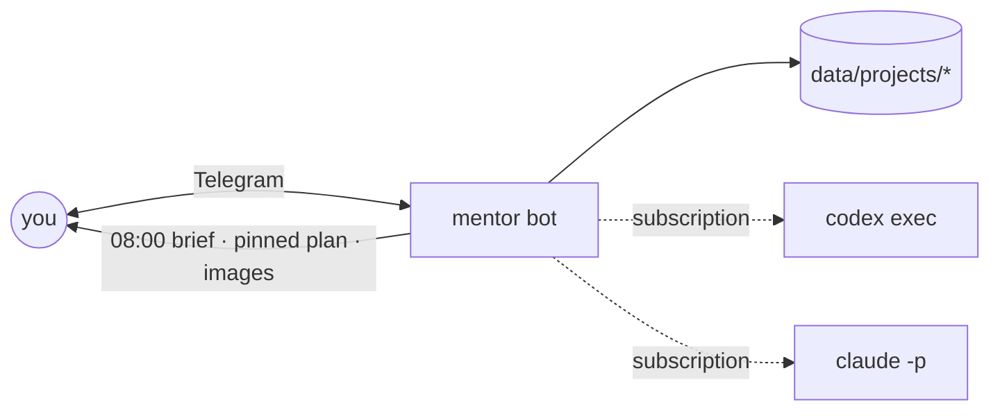

# Mentor bot

A personal Telegram mentor for anything you're working on: a business, a side project, a
job hunt, home chores, a move, studies. It keeps one pinned plan across all of them, sends a
morning brief with today's actions, and lets you change the plan by just talking to it.

It runs the `codex` and `claude` CLIs on your existing **ChatGPT or Claude subscription**, so
it needs no API keys. Python 3.12, standard library only.



## What it does

| You say | Bot does |
|---|---|
| "what's due this week?" | answers from plans and timelines |
| "move the dentist to Friday" | replans with a heavier model, updates the pinned message |
| "switch to gpt-6-astra high" | validates and changes model/effort |
| "send a Gantt of the plan" | renders Mermaid to PNG and posts it |
| "what's in the website repo?" | reads a project's linked folder or repo, read-only |
| (silent since yesterday, 08:00) | asks Yes/No, proposes moves for undone tasks, writes plan.md on Approve |
| "add project renovation" | creates `data/projects/renovation/` from the template |

While it works you see 👀 on your message and "typing…"; 🤔 means a heavy step is running.

## Quick start

```bash
uv venv && uv pip install -e '.[dev]'
cp .env.example .env         # TELEGRAM_BOT_TOKEN, TELEGRAM_CHAT_ID
cp -r data.example data       # your plans live here; keep it in its own private repo
codex login                  # or: claude setup-token -> CLAUDE_CODE_OAUTH_TOKEN in .env
mentor doctor                # checks Telegram + brain
mentor serve                 # long-poll; add --with-scheduler for built-in jobs
```

Get the token from @BotFather. For the chat ID, message your bot and read `message.chat.id` from
`getUpdates`.

## Projects

A project is anything with goals and dates: a product launch, a garden, taxes, a trip. Each one
is a folder. Copy `data/projects/_template/` and fill in:

```
data/projects/<name>/
  project.md    what it is, goals, optional "repo: /path/to/folder"
  timeline.md   events and deadlines
  plan.md       project-level plan
data/plan.md    cross-project plan, rendered into the pinned message
```

## Scheduled jobs

```bash
mentor job morning   # 08:00 check-in, then the daily brief (idempotent per day)
mentor job deadline  # 09:00: no answer to the check-in -> reconcile the plan
mentor job replan    # weekly replan
mentor job compact   # fold old chat history into summary.md
```

Run them from cron, systemd timers, or `mentor serve --with-scheduler`. See
[deploy/README.md](deploy/README.md) for all three and for Docker.

## Configuration

| Variable | Default | Purpose |
|---|---|---|
| `TELEGRAM_BOT_TOKEN` | required | bot token |
| `TELEGRAM_CHAT_ID` | required | the only chat the bot answers |
| `DATA_DIR` | `./data` | plans, projects, history, settings |
| `TZ` | `Europe/Kyiv` | schedule and "today" |
| `CLAUDE_CODE_OAUTH_TOKEN` | empty | enables the Claude brain |
| `KROKI_URL` | `https://kroki.io` | Mermaid renderer; self-host to keep plans private |

Chat and heavy model settings live in `data/settings.json` and are changed by chatting.

## Tests

```bash
.venv/bin/python -m pytest -q     # unit, use cases, e2e against a local Bot API stub
scripts/live_smoke.sh             # manual check with real Telegram and a real brain
```

## Architecture

Clean architecture, light: `domain/`, `usecases/`, `ports/`, `adapters/`, `app/`. The brain
never writes files. It returns `{reply, document, actions}`, and the use cases execute them.
Diagrams are in [docs/ARCHITECTURE.md](docs/ARCHITECTURE.md).

## Notes

- Codex on this setup runs with `--ignore-user-config`, stdin closed, and a read-only sandbox.
- On Ubuntu 24.04, apply `deploy/apparmor-bwrap` so the Codex sandbox can start.
- A single-user bot on your own subscription matches the documented CI use of these CLIs. Do not
  offer it to others on your login.
