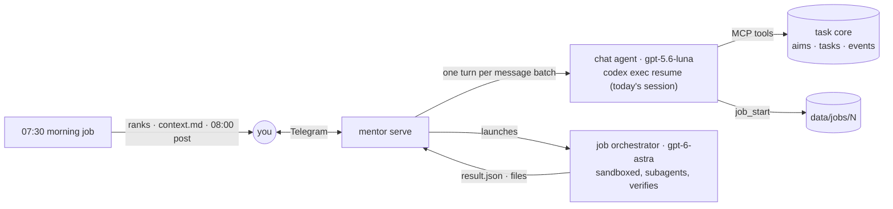

# Mentor bot

A personal Telegram assistant. You talk to one cheap, persistent chat agent; it keeps the conversation and your
aims and tasks, and hands real work to background jobs run by a smarter agent that plans, fans out subagents,
verifies, and reports back. Nothing happens unless you ask, except one morning post with today's priorities.

It runs the `codex` CLI on your ChatGPT subscription (Claude Code CLI as the automatic fallback), so it needs no
API keys. Python 3.12, standard library only.



## What you can say

| You say | What happens |
|---|---|
| "add a task: send the CV to Acme by Friday" | task core `task_add` (deadline resolved to a date) |
| "pause it" / "resume" / "disable" / "done" / "remove" | `task_set_status`; "it" comes from the conversation |
| "add an aim: get a job, target December" | `aim_add` |
| "what's on my plate?" | answered from the task list |
| "research X and give me a summary file" | job N started; later a report and the file in chat |
| "fix the bug in repo Y" | a job works in `Y/.worktrees/job-N` on branch `job/N`, commits, never pushes |
| "what are my jobs?" / "cancel job 4" | `job_list` / `job_cancel` |
| "draw my aims as a diagram" | Mermaid → PNG via Kroki |
| "what did we decide last Tuesday?" | `recall` over day summaries and transcripts |

## What jobs may do

Jobs push as far as possible and stop right before anything outward-facing: no sending, submitting, posting,
buying, pushing or merging. Emails are written to a file, forms are filled but not submitted, code is committed
on a worktree branch. They never ask mid-way; they assume and list their assumptions in the report.

Sandbox (Codex permission profile, enforced by bubblewrap): write access to `~/dev`, `~/Документи`,
`~/Downloads` and the job folder; read access elsewhere except credentials (`~/.ssh`, `~/.codex/auth.json`, browser
profiles, every `.env*`, `*.pem`, `*.key` under `~/dev`, ...). No tokens or SSH agent in the job environment,
and `git` over ssh is disabled. Jobs keep your Codex MCP servers (browser, serena, ...) except `node_repl`.

## Memory

- Today's chat is one agent session; messages arriving during a turn are batched into the next.
- 07:30: the morning job writes `data/days/<yesterday>.md`, rewrites `data/context.md` (rolling memory), ranks
  tasks (the only thing it changes), posts at 08:00 and starts a fresh session seeded with context and tasks.
- Every task change is appended to `data/events.jsonl`.

## Quick start

```bash
uv venv && uv pip install -e '.[dev]'
cp .env.example .env          # TELEGRAM_BOT_TOKEN, TELEGRAM_CHAT_ID, full PATH
cp -r data.example data        # keep it in its own private repo
.venv/bin/mentor doctor        # sends "doctor: ok" to the chat
.venv/bin/mentor serve
```

Tests run in Docker: `docker compose run --rm test`. Deploy: [deploy/README.md](deploy/README.md).
Architecture: [docs/ARCHITECTURE.md](docs/ARCHITECTURE.md). Models per role: `data/settings.json`.
