# Mentor assistant bot — architecture

Status 2026-10-02: built, 143 tests, live-tested, running as a systemd user service.
Published page with the same diagrams: https://claude.ai/artifact/Kz2GVi8aQ5SpxxtQVg1HFD

## 1. What it is

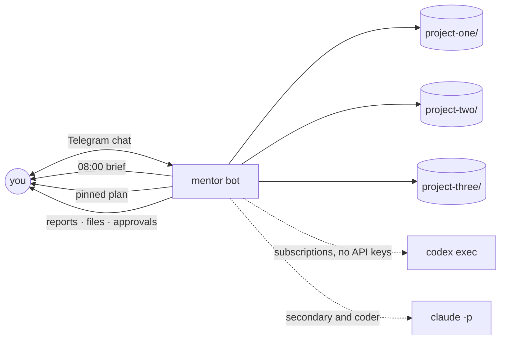

## 2. How subscriptions reach the bot

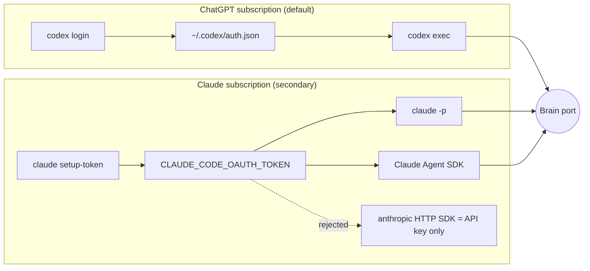

Never `claude --bare` (ignores OAuth). No SDK for ChatGPT subscription: subprocess only.

## 3. Layers

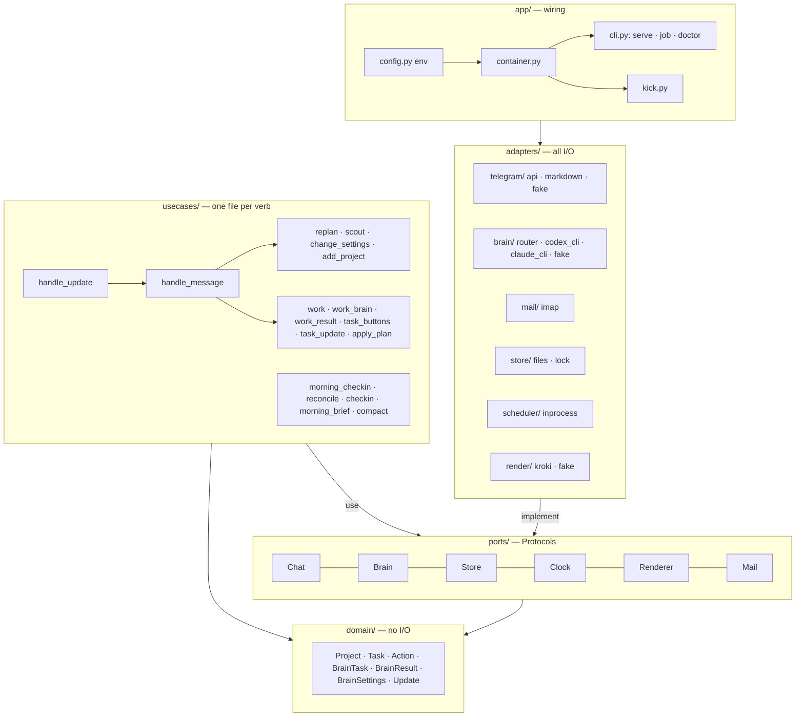

Arrows point inward only. Telegram → Slack, files → S3, CLI → SDK = new adapter folder + one line in `container.py`.

## 4. A chat message

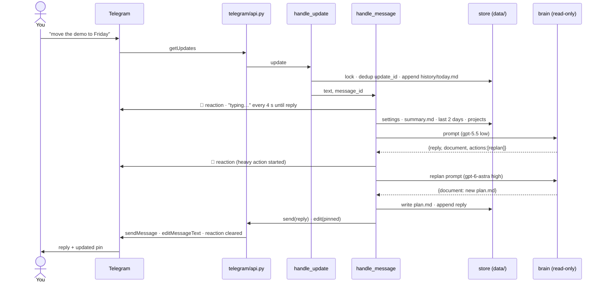

## 5. Brain: cheap chat, heavy planners, a write-enabled worker

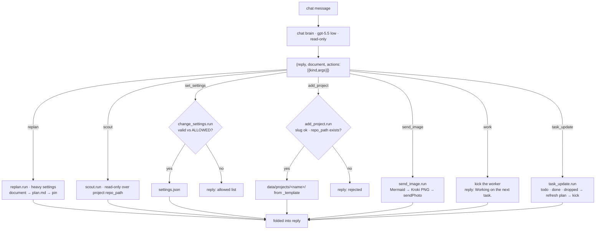

Images: the brain never renders. It emits `send_image{diagram, caption}`; the use case posts the
PNG from Kroki (`KROKI_URL`, default kroki.io, self-hostable) and a failure lands in the reply text.

`task_result` is a worker-only kind. The chat prompt forbids it and `output_schema.json` lists all
eight kinds: replan, scout, set_settings, add_project, send_image, work, task_update, task_result.

### Routing

`RoutingBrain` picks the adapter from `BrainTask.settings.provider` and builds each one once;
an unknown provider returns `brain error: unknown provider`. Three tiers in `settings.json`
(`domain/settings.py` `tier`):

| Tier | Used for | Default |
|---|---|---|
| chat (top-level) | chat, scout, compact | gpt-5.5 low |
| `heavy` | replan, reconcile, `research` and `writing` tasks | gpt-6-astra high |
| `coder` | `coding` and `system` tasks | claude sonnet high |

A task can run on the other tier's provider when `task.provider` names it (the
"Approve · other provider" button sets this).

### Who writes files

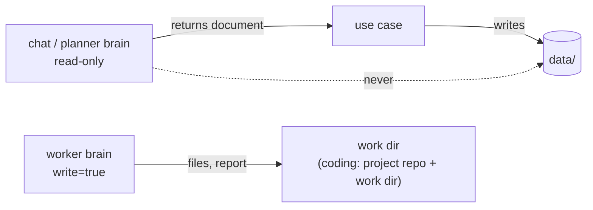

Chat and planning stay read-only. Only the worker gets `write=True`, with `cwd` = its work dir
(the project repo for `coding` tasks, plus the work dir via `extra_dirs`).

| Provider | Read mode | Write mode (worker) |
|---|---|---|
| Codex | `-s read-only` | `-s workspace-write`, network on, `web_search=live`, `--add-dir` for extra dirs; kernel-sandboxed by bubblewrap |
| Claude | tools `Read,Grep` | tools `Read,Grep,Glob,Write,Edit,Bash,WebSearch,WebFetch`, `acceptEdits`; permission rules only, no kernel sandbox |

With `BROWSER_CDP_URL` set, write mode also attaches an MCP server named `browser`
(`@playwright/mcp` via `npx`, `--cdp-endpoint`) to both providers. Read-only browsing, "never
submit" and "never send" are prompt rules in `prompts/work.md` and `work_brain.py`, not enforced.

Why Codex read mode is read-only: `workspace-write` needs bubblewrap; Ubuntu 24.04 blocks
unprivileged userns. `deploy/apparmor-bwrap` (per-binary profile) lets shell commands run in the sandbox.

### One Codex call

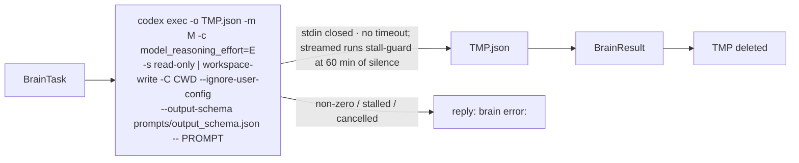

Streaming: when `BrainTask.on_step` is set (worker, replan, scout), Codex adds `--json` (JSONL events on
stdout, `-o` still holds the answer) and Claude uses `--output-format stream-json --verbose` (the closing
`result` event is the json-mode output). `adapters/brain/stream.py` reads stdout line by line, enforces the
stall guard and cancel() (kill the process group) and maps tool calls to short lines ("ran `ls`", "edited a.txt").
Unknown or broken events are skipped. Without `on_step` the commands are unchanged.

`--ignore-user-config`: this machine's `~/.codex/config.toml` routes to a local proxy and MCP servers that hang headless.

### Allowed models (`domain/settings.py`)

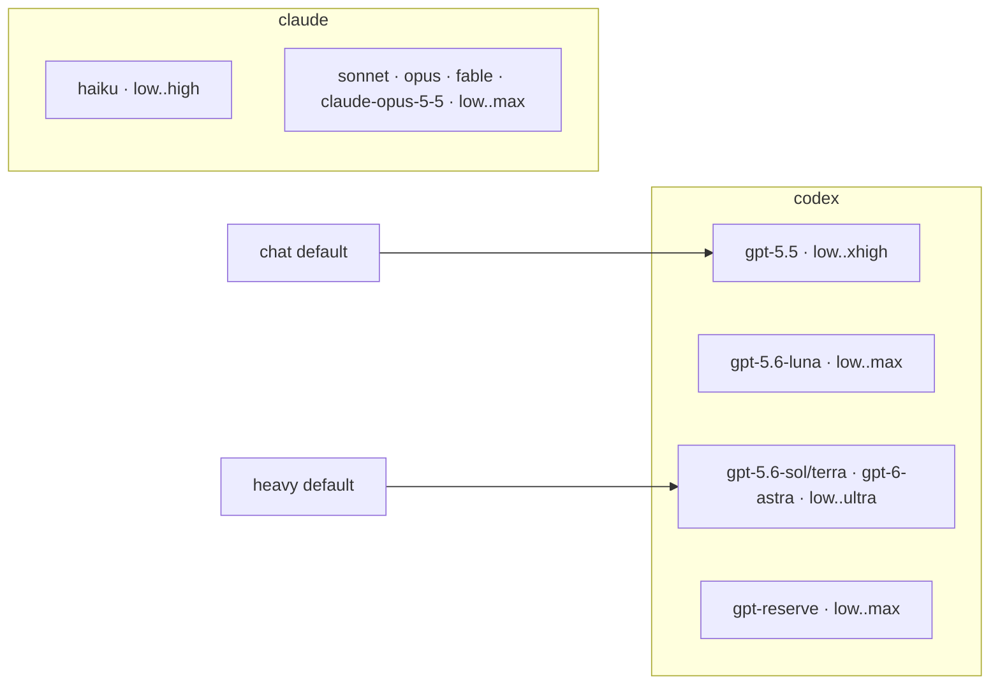

## 6. Task graph and work loop

`data/tasks.json` is the source of truth. `data/plan.md` and the pinned message are rendered
from it by `apply_plan.refresh` after every change (Next / In progress / Waiting on you / Failed /
Then / Done n of m). Replan and check-in Approve write the graph through `apply_plan.run`: parse,
reject cycles or unknown deps, then merge so runtime fields (`files`, `approved`, `provider`,
`proposal`) and non-final statuses survive. A running task missing from the new graph is kept.

Task: `id`, `title`, `project`, `kind` (`research` `writing` `coding` `system` `user`), `deps`,
`due`, `status`, `note`, plus runtime fields. The next task is the first `todo` in list order
whose deps are all `done` or `dropped`, so a parked, failed or awaiting task blocks its dependents.

### Statuses

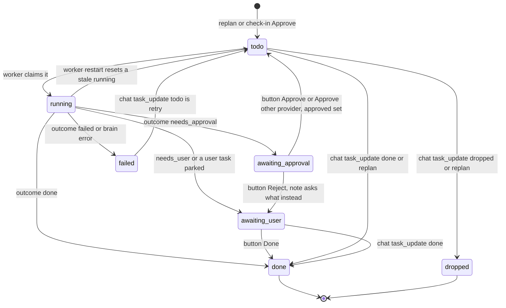

Chat `task_update` accepts only `todo`, `done`, `dropped` for any task id; replan may only set
those same three. Buttons are compare-and-set: a press on a task no longer in the expected
status answers "Already handled." Approve with another provider sets `task.provider`.

### One loop iteration

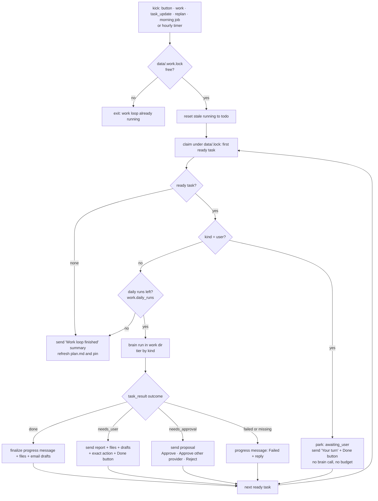

Progress message (`usecases/progress.py`): each worker run, replan and scout posts one HTML message
(`Chat.send_html`) — `⏳ title`, `kind · provider model · effort E · elapsed`, the step log in a
`<blockquote>` — re-rendered every 10 s by a daemon thread (`edit_html`). On finish the same message
becomes `✅ Done` / `🟡 Prepared` / `🟠 Needs approval` / `❌ Failed`, total time, the log collapsed
(`<blockquote expandable>`) and, for worker tasks, the brief plus the files list; replan and scout end
with just the status and keep their usual reply. It stays under 4096 chars: older steps are counted as
"(N earlier steps in steps.md)", a long brief is cut with "…" (full text in `report.md`). Every step
is also appended with a timestamp to `steps.md` in the work dir. Telegram errors are printed, never raised.
Buttons, files and drafts follow as separate plain-text messages.

Details:

- Work dir: `data/projects/<name>/work/<task id>/` (`data/work/<id>/` without a project). Dependencies'
  `report.md` paths and files are listed in the prompt as inputs.
- A run that is not a `user` task costs one of `work.daily_runs` (default 12 per day, counted in
  `state.json` `work`). Past the budget the loop stops and says so.
- Files are sent only from the work dir or project repo, up to 50 MB each. Email drafts go to Gmail
  Drafts over IMAP (`adapters/mail/imap.py`, `Mail.draft`); with no mail configured, or on an
  IMAP error, the draft text is sent in Telegram instead. Nothing is ever sent as email.
- Single instance: `mentor job work` takes `data/.work.lock` non-blocking. Kicked runs
  (`app/kick.py`, detached subprocess) log to `data/work.log`.

## 7. Projects are folders

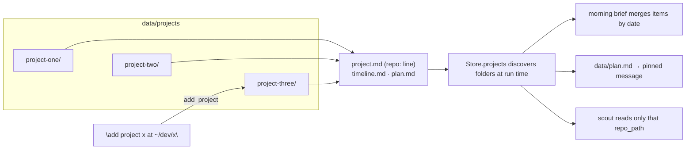

## 8. Scheduler is the command line

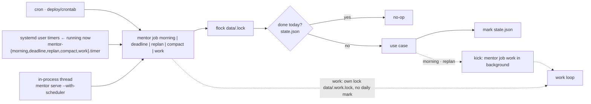

| Job | When (Europe/Kyiv) | Brain |
|---|---|---|
| morning check-in → brief | daily 08:00 | chat; heavy if reconciling |
| check-in deadline | daily 09:00 | heavy (reconcile) if still pending |
| replan | Sunday 20:00 | heavy settings |
| compact | Sunday 21:00 | chat settings |
| work | hourly safety net, plus kicks | `heavy` or `coder` per task kind |

The weekly replan and the morning job kick the worker when they finish. A chat replan, a button
press (other than Reject), the chat actions `work` and `task_update` kick it too. Check-in Approve
and the 09:00 deadline job do not kick; the next kick or the hourly timer picks the new tasks up.

### Morning check-in

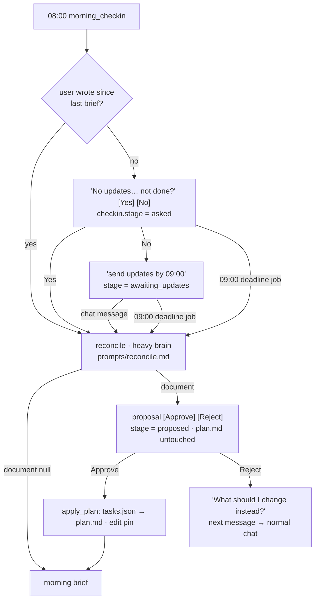

State lives in `state.json` `checkin`; each transition is claimed under `data/.lock`, so a button
and the 09:00 job never both act. A press on a stale stage or old message → "Already handled."

## 9. Memory

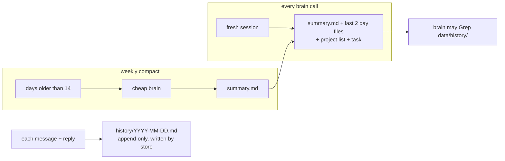

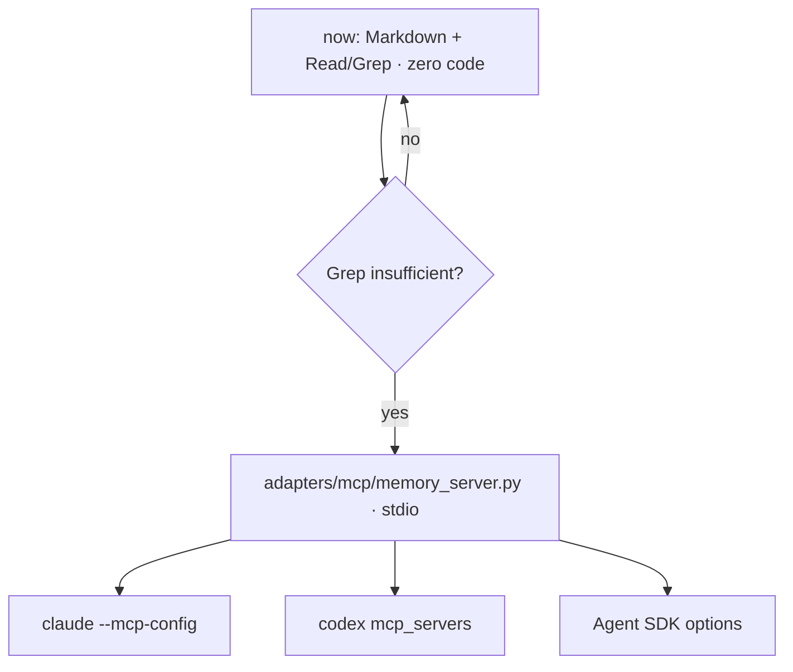

## 10. Files

```
mentor/
  domain/      settings.py actions.py project.py conversation.py tasks.py
  usecases/    handle_update.py handle_message.py busy.py morning_brief.py replan.py
               scout.py compact.py change_settings.py add_project.py send_image.py
               morning_checkin.py checkin.py checkin_state.py reconcile.py
               apply_plan.py work.py work_brain.py work_result.py progress.py task_buttons.py task_update.py
  ports/       chat.py brain.py store.py clock.py renderer.py mail.py
  adapters/    telegram/{api,markdown,fake}.py  brain/{router,codex_cli,claude_cli,stream,fake}.py
               store/{files,lock}.py  scheduler/inprocess.py  render/{kroki,fake}.py  mail/imap.py
  app/         config.py container.py cli.py jobs.py kick.py
data/          tasks.json plan.md settings.json state.json work.log history/
               projects/{_template,<name>}/{...,work/<task id>/}
prompts/       mentor.md replan.md reconcile.md work.md scout.md morning.md compact.md output_schema.json
deploy/        crontab mentor.service mentor-*.{service,timer} (incl. mentor-work) apparmor-bwrap README.md
tests/         unit/ usecases/ e2e/     scripts/live_smoke.sh     Dockerfile compose.yml
```

| Change… | Where |
|---|---|
| personality, rules | `prompts/mentor.md` |
| a project's deadlines | `data/projects/<name>/timeline.md`, or tell the bot |
| chat / heavy model | tell the bot (`set_settings`) → `data/settings.json` |
| coder model, work budget | `data/settings.json` `coder`, `work.daily_runs` |
| what the worker may do alone | `prompts/work.md` (a prompt rule, not enforced) |
| task kinds, statuses, ordering | `domain/tasks.py` |
| a task's outcome handling, buttons | `usecases/work_result.py`, `task_buttons.py` |
| email drafts | `adapters/mail/imap.py`; `GMAIL_USER`, `GMAIL_APP_PASSWORD` |
| allowed models | `domain/settings.py` ALLOWED |
| when jobs run | active scheduler (`deploy/`) |
| Telegram → Slack | new `adapters/` folder + one line in `container.py` |

## 11. Config and secrets

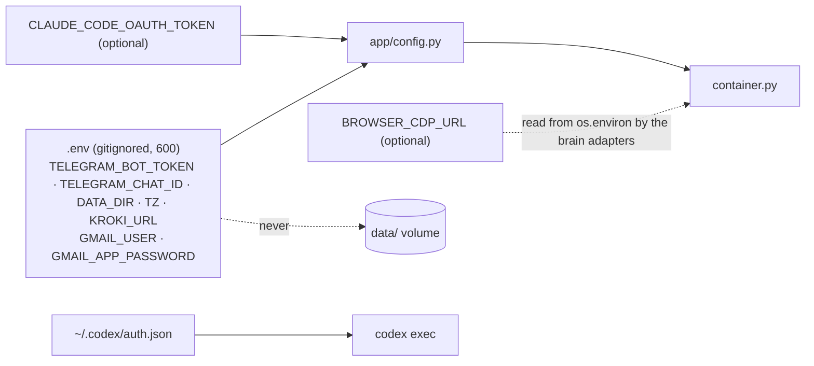

## 12. Tests

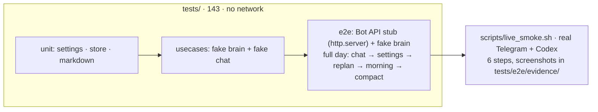

## 13. Hosting now and later

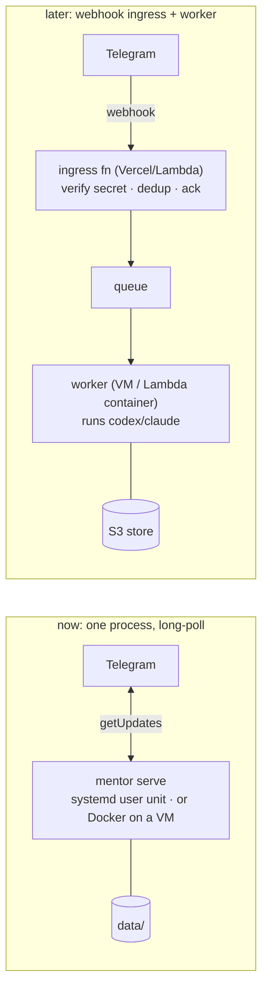

Already in place for "later": `handle_update` is the single inbound entry, no memory between updates, `Store` is a port, config from env only.

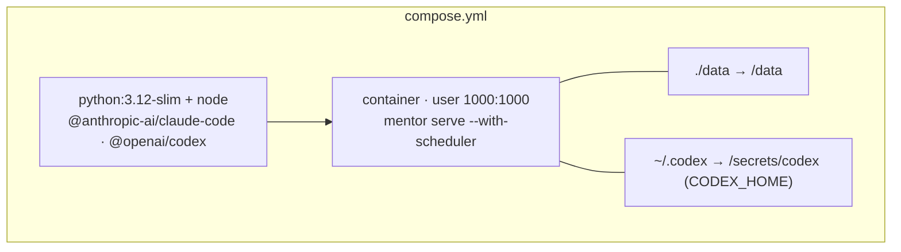
