# Mentor bot — architecture

Status 2026-09-29: built, 47 tests, live-tested, running as a systemd user service.
Published page with the same diagrams: https://claude.ai/artifact/Kz2GVi8aQ5SpxxtQVg1HFD

## 1. What it is

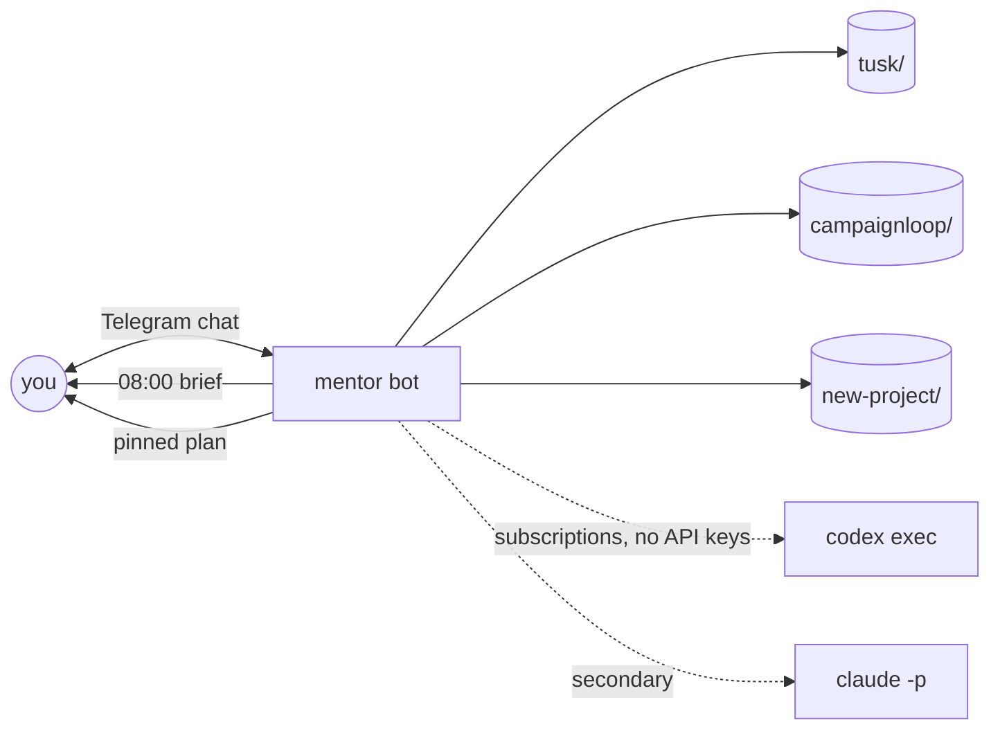

## 2. How subscriptions reach the bot

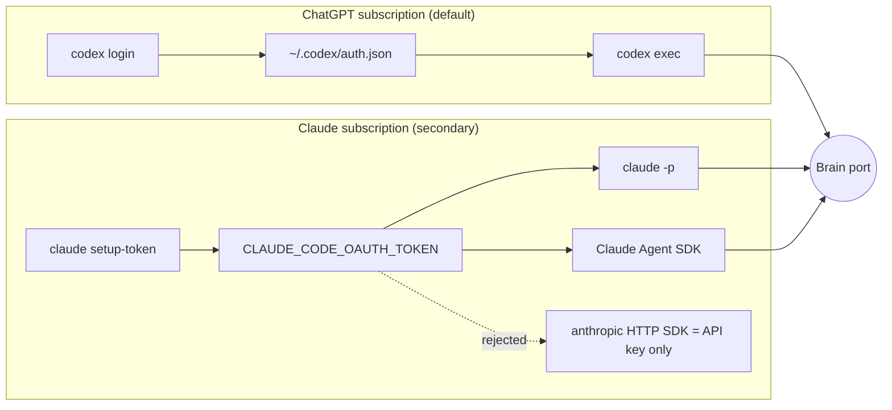

Never `claude --bare` (ignores OAuth). No SDK for ChatGPT subscription: subprocess only.

## 3. Layers

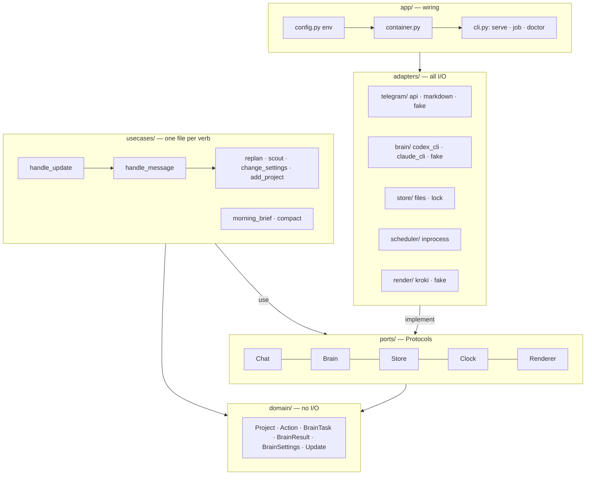

Arrows point inward only. Telegram → Slack, files → S3, CLI → SDK = new adapter folder + one line in `container.py`.

## 4. A chat message

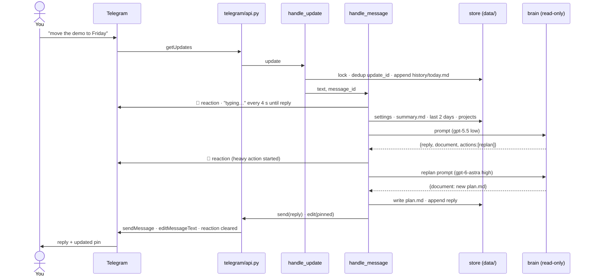

## 5. Brain: cheap chat, heavy workers, code executes

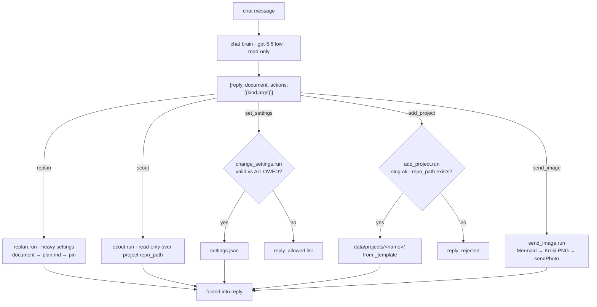

Images: the brain never renders. It emits `send_image{diagram, caption}`; the use case posts the
PNG from Kroki (`KROKI_URL`, default kroki.io, self-hostable) and a failure lands in the reply text.

### Who writes files

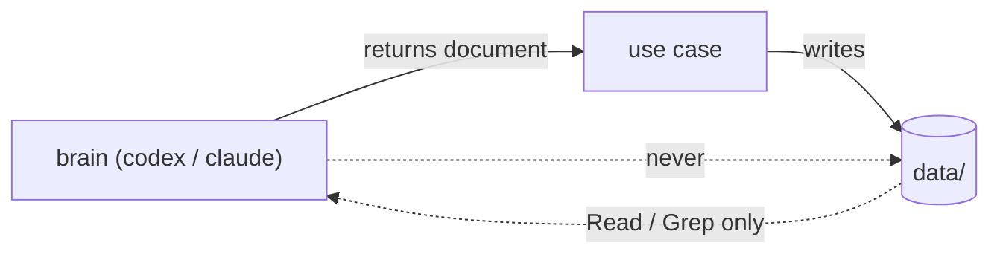

Why: Codex `workspace-write` needs bubblewrap; Ubuntu 24.04 blocks unprivileged userns.
`deploy/apparmor-bwrap` (per-binary profile) lets shell commands run in the read-only sandbox.

### One Codex call

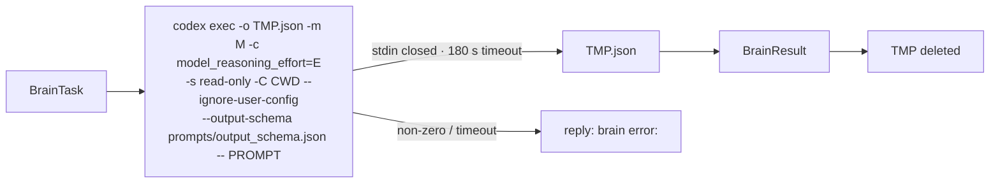

`--ignore-user-config`: this machine's `~/.codex/config.toml` routes to a local proxy and MCP servers that hang headless.

### Allowed models (`domain/settings.py`)

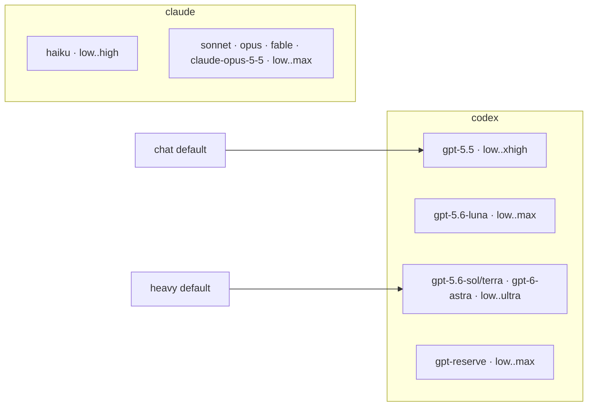

## 6. Projects are folders

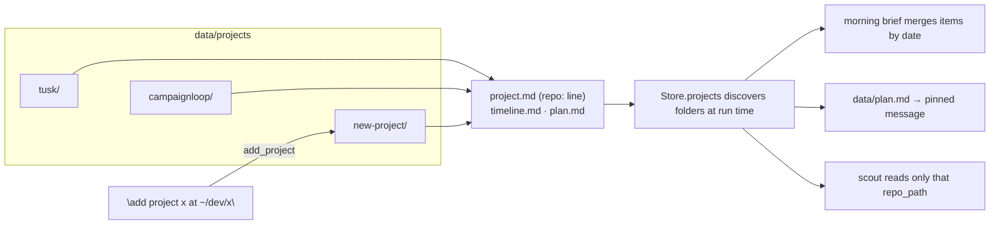

## 7. Scheduler is the command line

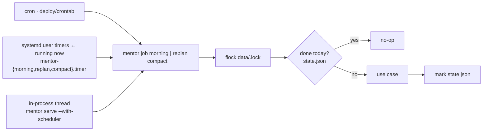

| Job | When (Europe/Kyiv) | Brain |
|---|---|---|
| morning brief | daily 08:00 | chat settings |
| replan | Sunday 20:00 | heavy settings |
| compact | Sunday 21:00 | chat settings |

## 8. Memory

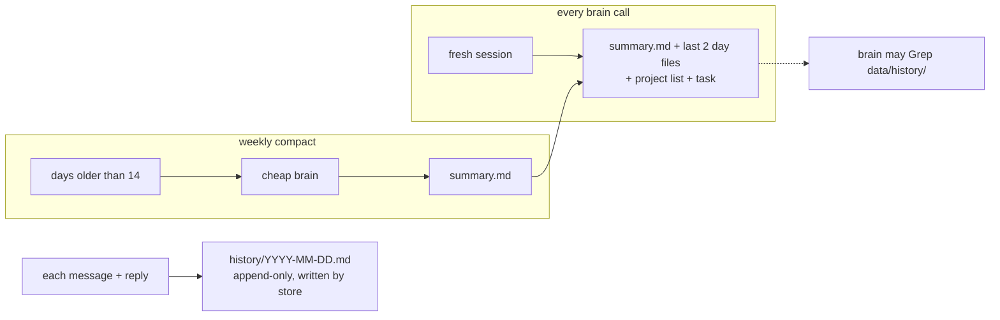

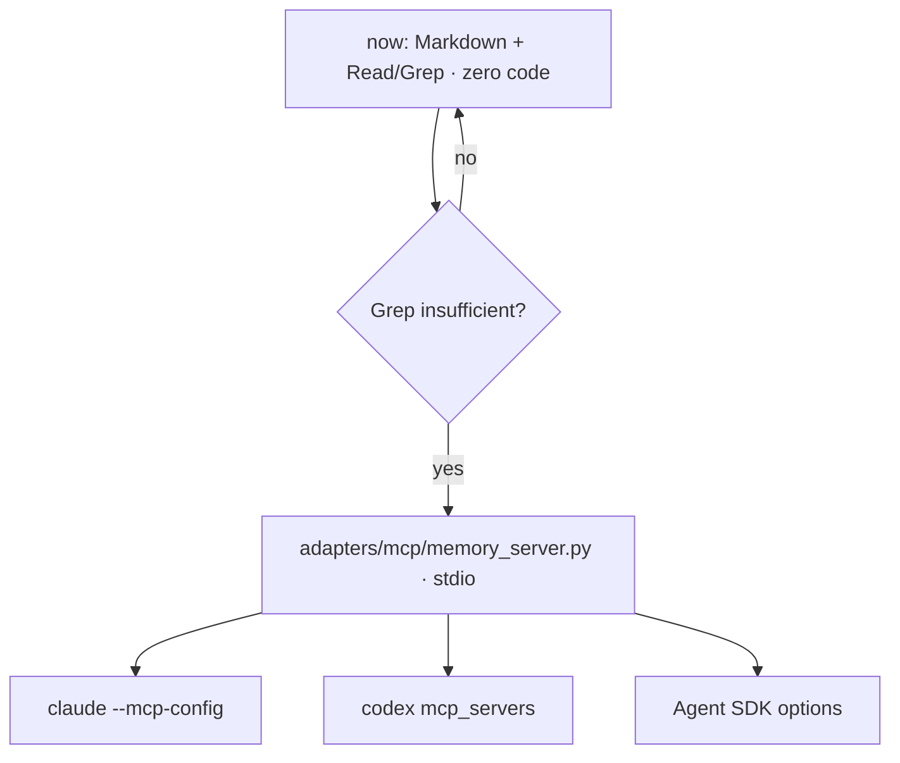

## 9. Files

```
mentor/
  domain/      settings.py actions.py project.py conversation.py
  usecases/    handle_update.py handle_message.py busy.py morning_brief.py replan.py
               scout.py compact.py change_settings.py add_project.py send_image.py
  ports/       chat.py brain.py store.py clock.py renderer.py
  adapters/    telegram/{api,markdown,fake}.py  brain/{codex_cli,claude_cli,fake}.py
               store/{files,lock}.py  scheduler/inprocess.py  render/{kroki,fake}.py
  app/         config.py container.py cli.py jobs.py
data/          plan.md settings.json state.json history/ projects/{_template,<name>}/
prompts/       mentor.md replan.md scout.md morning.md compact.md output_schema.json
deploy/        crontab mentor.service mentor-*.{service,timer} apparmor-bwrap README.md
tests/         unit/ usecases/ e2e/     scripts/live_smoke.sh     Dockerfile compose.yml
```

| Change… | Where |
|---|---|
| personality, rules | `prompts/mentor.md` |
| a project's deadlines | `data/projects/<name>/timeline.md`, or tell the bot |
| chat / heavy model | tell the bot (`set_settings`) → `data/settings.json` |
| allowed models | `domain/settings.py` ALLOWED |
| when jobs run | active scheduler (`deploy/`) |
| Telegram → Slack | new `adapters/` folder + one line in `container.py` |

## 10. Config and secrets

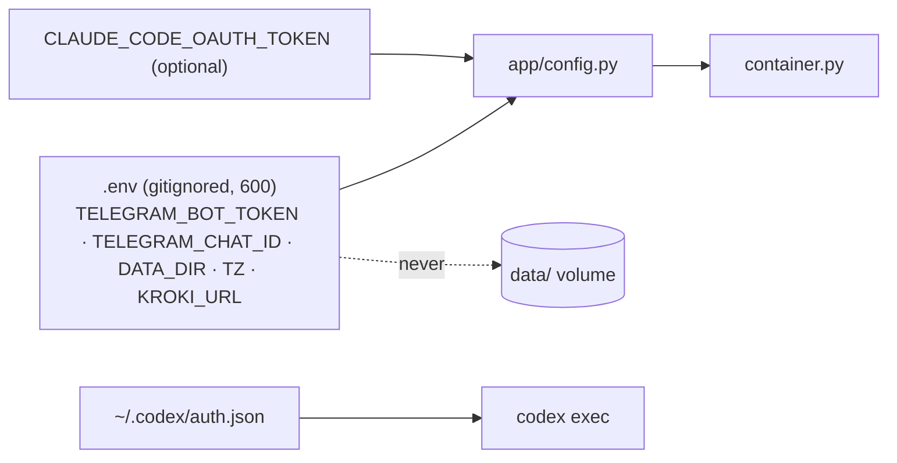

## 11. Tests


## 12. Hosting now and later

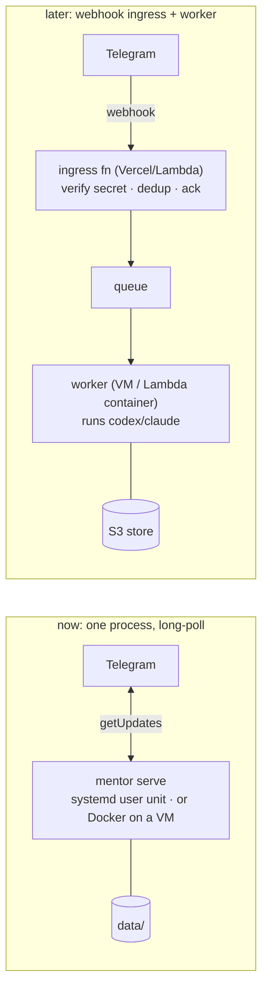

Already in place for "later": `handle_update` is the single inbound entry, no memory between updates, `Store` is a port, config from env only.

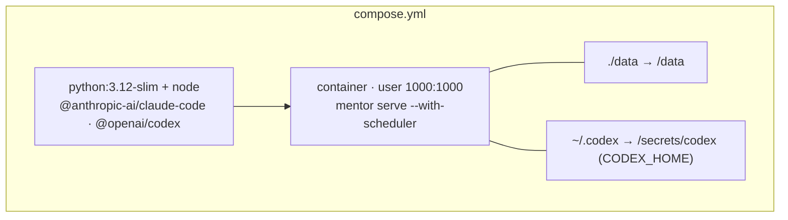
