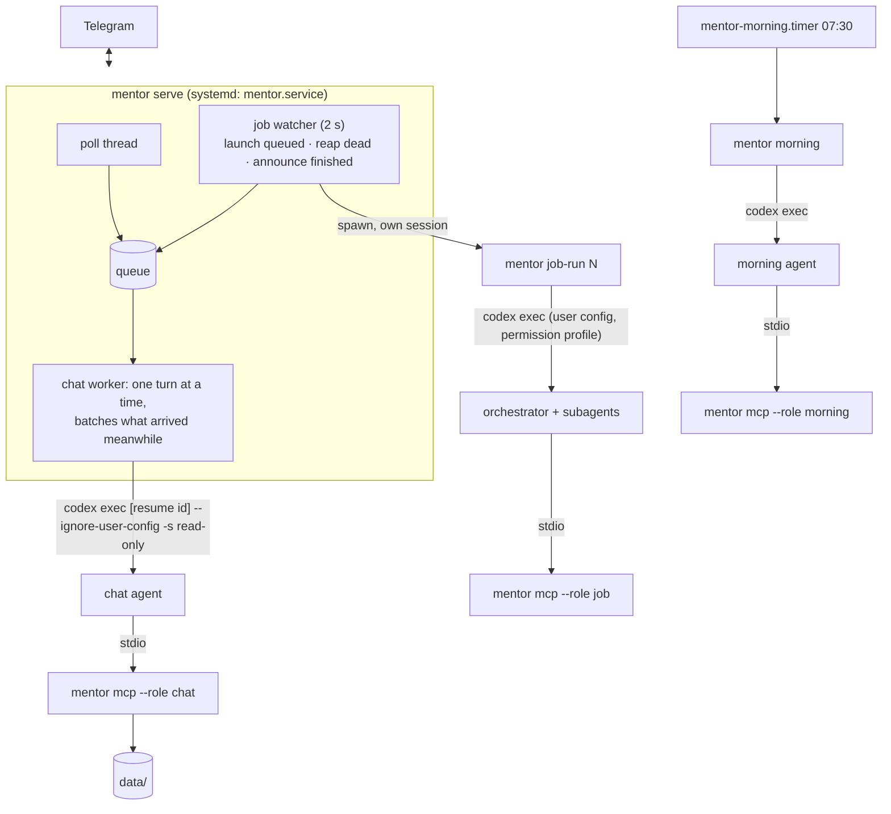

# Mentor bot v3: architecture

Last updated: 2026-10-11 (projects, live job status). v2 (task graph, autonomous worker, replans, check-ins, buttons) was replaced because it
acted without being asked. v3: a cheap conversational agent, a deterministic task core, background jobs on demand.

## Processes

## Code layout

| Path | What |
|---|---|
| `mentor/domain/tasks.py` | `Agenda` (aims + tasks, each optionally in a project), validated ops, `render` |
| `mentor/domain/agent.py`, `settings.py` | `AgentRun` / `AgentResult` / `Sandbox`; model tiers per role |
| `mentor/adapters/agent/` | `codex.py`, `claude.py` (CLI command + event parsing), `agents.py` (by provider), `stream.py` (JSONL runner with stall kill), `secrets.py` (deny-read list, env scrub), `mentor_mcp.py` |
| `mentor/adapters/store/` | `files.py` (state, agenda + events, history, context, days, projects), `jobs.py` (`JobBook`), `lock.py` |
| `mentor/adapters/telegram/` | Bot API over urllib; Markdown → Telegram HTML with plain-text fallback |
| `mentor/mcp/` | `server.py` (stdio JSON-RPC), `tools.py` (tool table per role) |
| `mentor/usecases/` | `gateway`, `chat_turn`, `jobs`, `job_run`, `job_progress`, `job_announce`, `morning`, `migrate`, `recall`, `oneshot`, `send_image`, `add_project` |
| `prompts/` | `chat.md`, `job.md`, `morning.md`, `migrate.md` |

## Data (`DATA_DIR`, its own git repo)

`tasks.json` (aims, tasks; `project` = a folder name under `projects/`, a task defaults to its aim's), `events.jsonl` (every task op, `by` chat/morning/user), `state.json` (`last_update_id`,
`chat {tier, session}`, `last_morning`), `history/<date>.md` (transcript), `context.md`, `days/<date>.md`,
`jobs/<N>/{brief.md, job.json (+ `status_msg`), steps.log, run.log, result.json, out/}`, `projects/<name>/project.md` (`repo:` line),
`settings.json` (tiers), `legacy/tasks-v2.json`, `migration/tasks.json`.

## Key decisions and pitfalls

- **Chat speed.** `codex exec` with the user config takes ~17 s per turn (plugins, skills, MCP startup); with
  `--ignore-user-config` and only the mentor MCP, ~5 s per resumed turn. Jobs keep the user config for its MCPs.
- **Models.** The ChatGPT login rejects `gpt-6-luna` and `gpt-6.1-sol`; chat uses `gpt-5.6-luna`, jobs and morning
  `gpt-6-astra`. Claude: user settings break headless Haiku (`system.5.type`), so chat fallback passes
  `--setting-sources ""`.
- **Language.** luna drifts into Russian after tool calls. Every turn gets a pin (`(Reply in English.)` for Latin
  script, Ukrainian for Cyrillic, never Russian); prompts say the same.
- **Sessions.** One per day; the morning job clears it. A broken resume restarts from a seed with today's transcript.
  A Codex usage limit (`hit your usage limit` in `turn.failed`/`error`) moves chat to Claude Haiku for the rest of
  the day and reruns a job on Claude Opus.
- **Sandbox.** Codex permission profile `-c permissions.mentor.filesystem={...}` + `default_permissions="mentor"`.
  Codex deny-read globs fail on unreadable dirs under `~/dev`, so `secrets.py` lists files by exact (resolved) path;
  a symlink in the deny list makes bwrap refuse to start. Claude fallback: sandbox settings with `Read(...)` deny and
  `Edit(...)` allow rules, network `allowedDomains: ["*"]`. Test outside a model: `codex sandbox -c ... -P mentor -- cmd`.
- **Jobs outlive the service** (`start_new_session`, `KillMode=process`). Cancel = status `cancelled` + SIGTERM to the
  runner's process group; a runner that vanished is reaped as failed. Reports are announced once (`announced`).
- **Live job status** (the etymology_bot pattern: one message edited in place). The chat reply that started a job
  ("job 7 started") gets a status block appended: elapsed time and the last 3 steps, edited at most every 10 s, then
  "✅ job 7 done". Jobs started in one turn share the reply. The report still comes as a new message, so it notifies.
- **MCP children get few env vars**: `DATA_DIR` and `TZ` are passed explicitly; `.env` is read from the repo cwd.
- **Telegram calls fail now and then** (TLS handshake timeouts): replies and reaction clears are retried 3 times; the
  chat worker never dies on one failed turn.

## Verification (2026-10-11, live through Telegram Web)

Chat reply, task add/pause/resume/rename with "it" resolution, memory across a session restart, research job with a
file, code job on a worktree branch (not pushed), parallel jobs, cancel, server restart mid-job, diagram, forced
usage limit (chat on Haiku, job on Opus), morning post + fresh session. Secrets: `codex sandbox` with the real deny
list denies `~/.ssh`, `.env`, `auth.json`; `git push` over ssh fails in the job environment.
